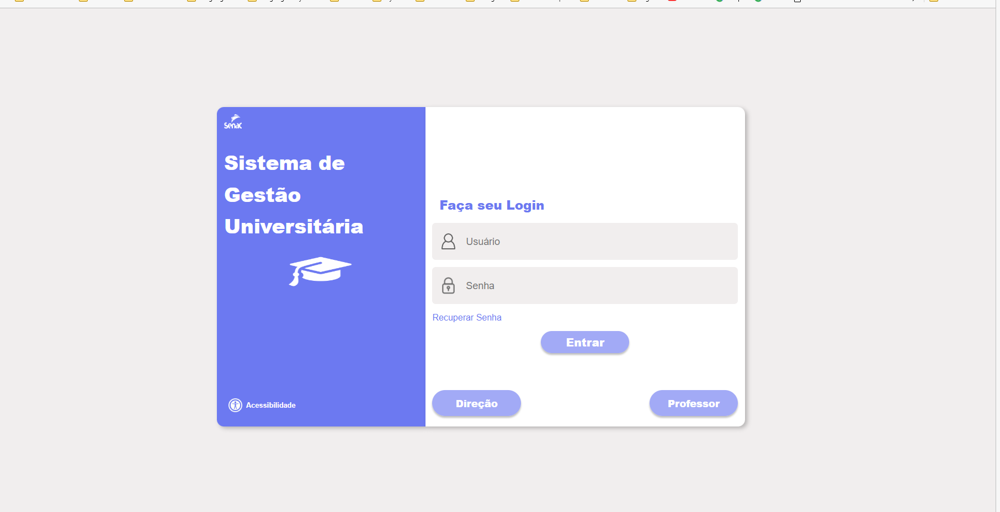
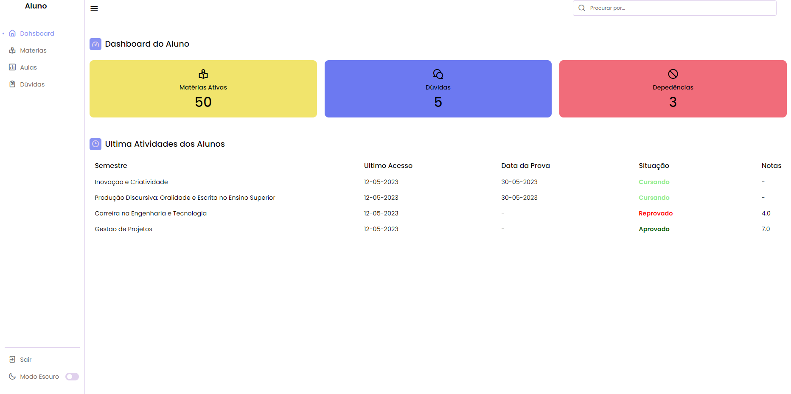
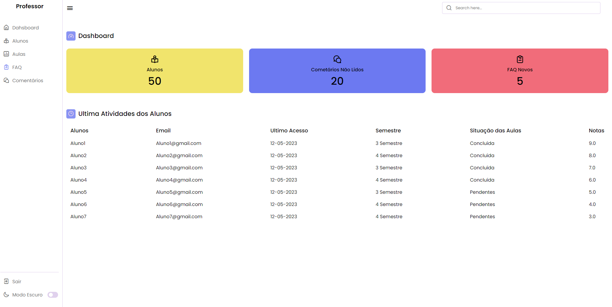
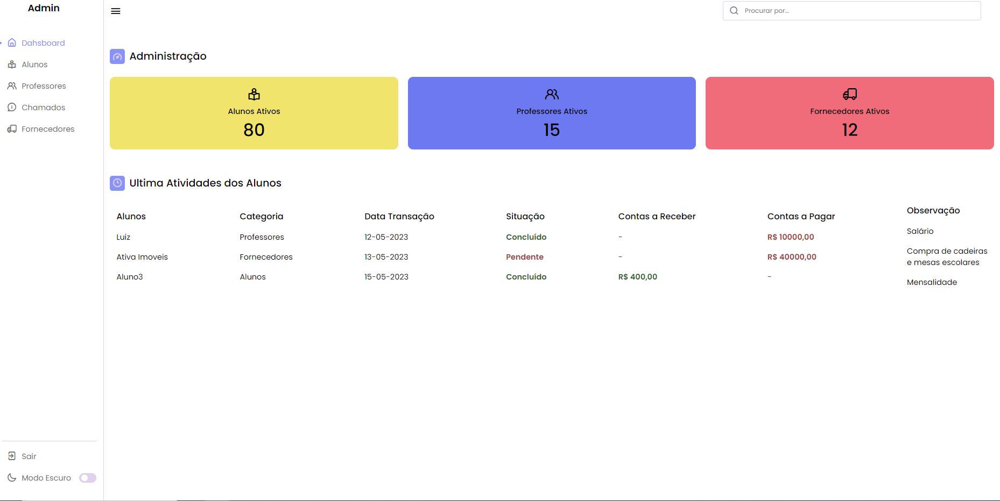

# Sistema de Gestão Universitária

Aplicação web em **Flask + SQLite** com login por perfil (**aluno**, **professor** e **diretor**), desenvolvida em grupo como **Projeto Integrador (PI) do curso de Análise e Desenvolvimento de Sistemas (ADS) do SENAC**, em 2023.

Cada perfil é direcionado para um painel próprio, com menu lateral recolhível e modo escuro.

> Parte da minha trilha de estudos — [github.com/CaioNepomuceno2](https://github.com/CaioNepomuceno2)

## Funcionalidades

- **Login com perfil:** o botão *Entrar* autentica alunos; os botões *Direção* e *Professor* autenticam os respectivos perfis.
- **Senhas com hash** (`werkzeug.security`, algoritmo scrypt) armazenadas no SQLite.
- **Sessão com controle de acesso:** cada painel só abre para o perfil correspondente; sem login, o usuário é redirecionado para a tela inicial. *Sair* encerra a sessão.
- **Painéis por perfil** (conteúdo de demonstração, fixo nos templates):
  - Aluno: matérias ativas, dúvidas, dependências, notas e situação por disciplina.
  - Professor: alunos, comentários, FAQ e últimas atividades dos alunos.
  - Diretor: alunos, professores e fornecedores ativos, contas a pagar e a receber.
- **Modo escuro** nos painéis e na tela de login (menu *Acessibilidade*), com a preferência salva no `localStorage`.
- **Banco criado automaticamente** na primeira execução, já com usuários de demonstração.

## Telas

| Login | Aluno |
|-------|-------|
|  |  |

| Professor | Diretor |
|-----------|---------|
|  |  |

## Como executar

Pré-requisito: Python 3.9 ou superior.

```bash
git clone https://github.com/CaioNepomuceno2/senac-university-management.git
cd senac-university-management

python -m venv .venv
# Windows
.venv\Scripts\activate
# Linux/macOS
source .venv/bin/activate

pip install -r requirements.txt
python app.py
```

Acesse <http://127.0.0.1:5000>. Na primeira execução o arquivo `users.db` é criado na pasta do projeto (ele não é versionado).

Variáveis de ambiente opcionais:

| Variável        | Uso                                                              | Padrão                       |
|-----------------|------------------------------------------------------------------|------------------------------|
| `SECRET_KEY`    | Chave usada para assinar a sessão. **Defina em produção.**       | chave fixa de desenvolvimento |
| `DATABASE_PATH` | Caminho do arquivo SQLite                                        | `users.db` na pasta do projeto |
| `FLASK_DEBUG`   | `1` ativa o modo de depuração do Flask                           | desativado                   |

## Usuários de demonstração

| Perfil    | Usuário       | Senha      | Botão na tela de login |
|-----------|---------------|------------|------------------------|
| Aluno     | `aluno01`     | `senha123` | Entrar                 |
| Professor | `professor01` | `senha123` | Professor              |
| Diretor   | `diretor01`   | `senha123` | Direção                |

Para cadastrar outros usuários: `python -c "import db; db.add_user('novo', 'senha', 'aluno')"`.

## Tecnologias

- Python, Flask 3 e Werkzeug (hash de senhas)
- SQLite (módulo `sqlite3` da biblioteca padrão)
- HTML, CSS e JavaScript (templates Jinja2, `fetch` para o login, ícones Unicons)

## Estrutura

```
sistema-gestao-universitaria/
├── app.py              # rotas Flask, login e controle de acesso por perfil
├── db.py               # criação do banco, hash das senhas e usuários de demonstração
├── requirements.txt
├── static/
│   ├── styles.css      # estilos da tela de login
│   ├── css/style.css   # estilos dos painéis
│   └── img/            # logotipos, ícones e capturas de tela
└── templates/
    ├── index.html      # tela de login
    ├── aluno.html
    ├── professor.html
    ├── dashboard.html  # variação do painel do professor (rota /dashboard)
    └── diretor.html
```

## Limitações conhecidas

- Os dados exibidos nos painéis são estáticos (escritos nos templates); apenas o login usa o banco de dados.
- "Recuperar senha", busca e os itens do menu lateral são apenas visuais.
- É um projeto acadêmico: para produção seriam necessários, por exemplo, proteção CSRF, servidor WSGI e cadastro de usuários pela interface.

## Equipe

Projeto desenvolvido em grupo pelos alunos:

- Barbara Gomes Barbosa
- Bruno Santos Souza
- Caio Henrique Nepomuceno Santos
- Carolina Cristina Alves Cardoso
- Guilherme Gabriel da Silva
- Rodolfo Saldanha Jardim
- Rodrigo Santos de Aquino
